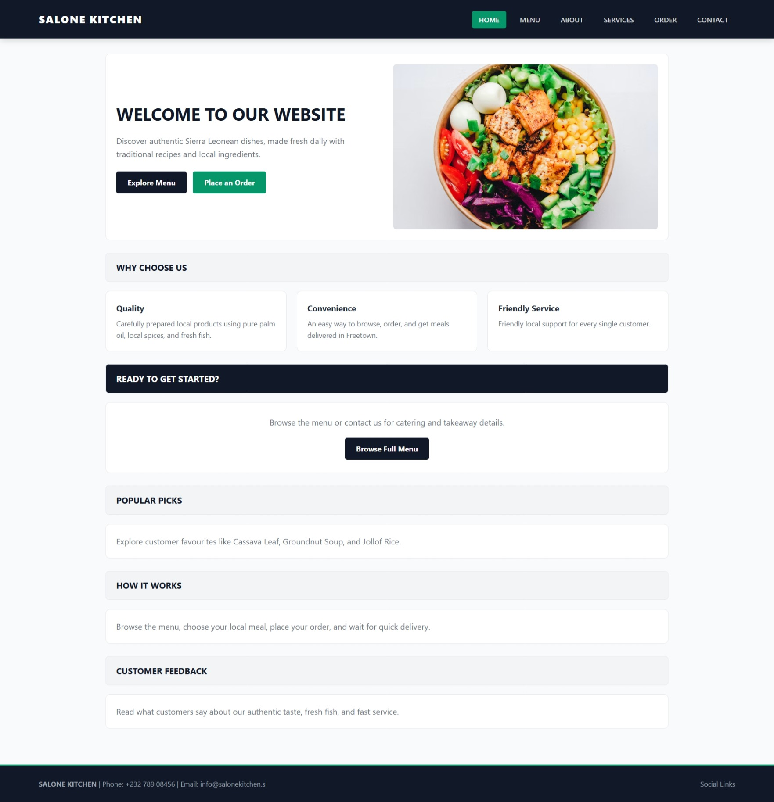
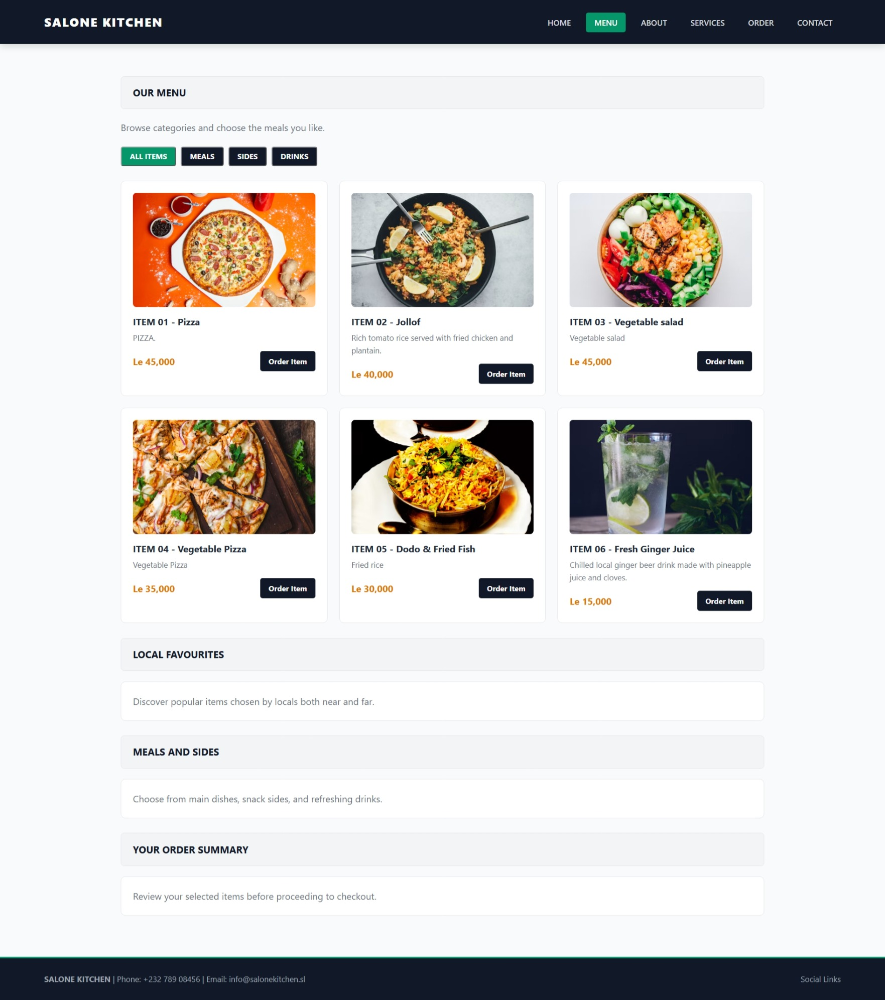
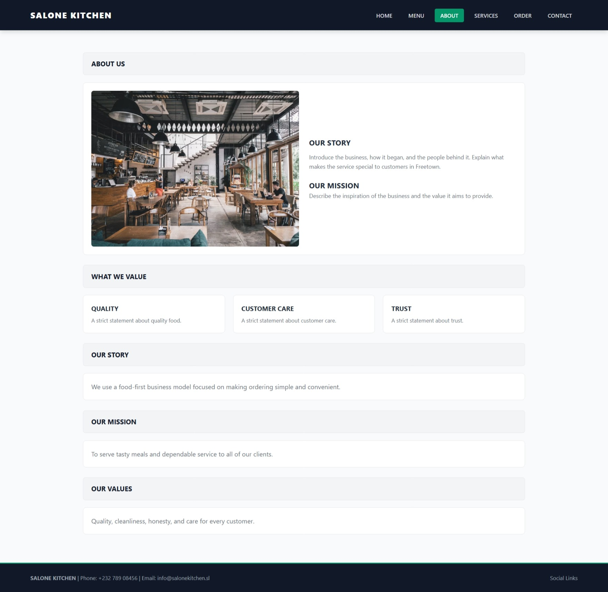
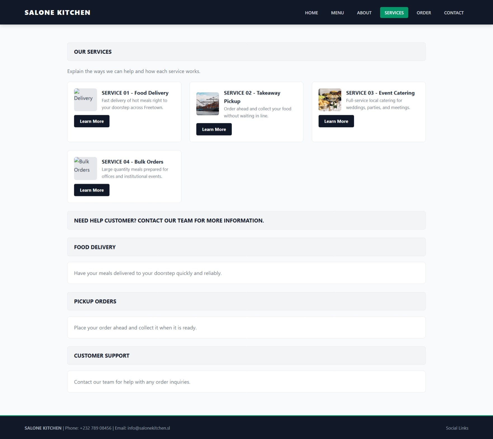
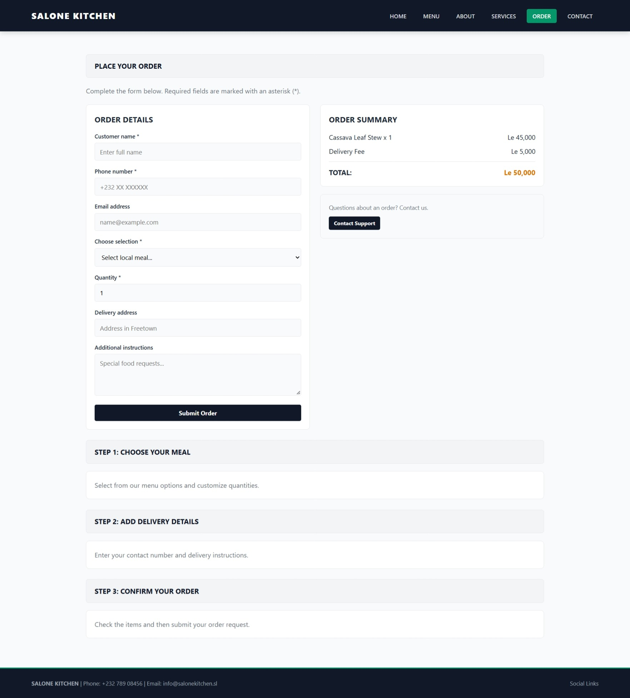
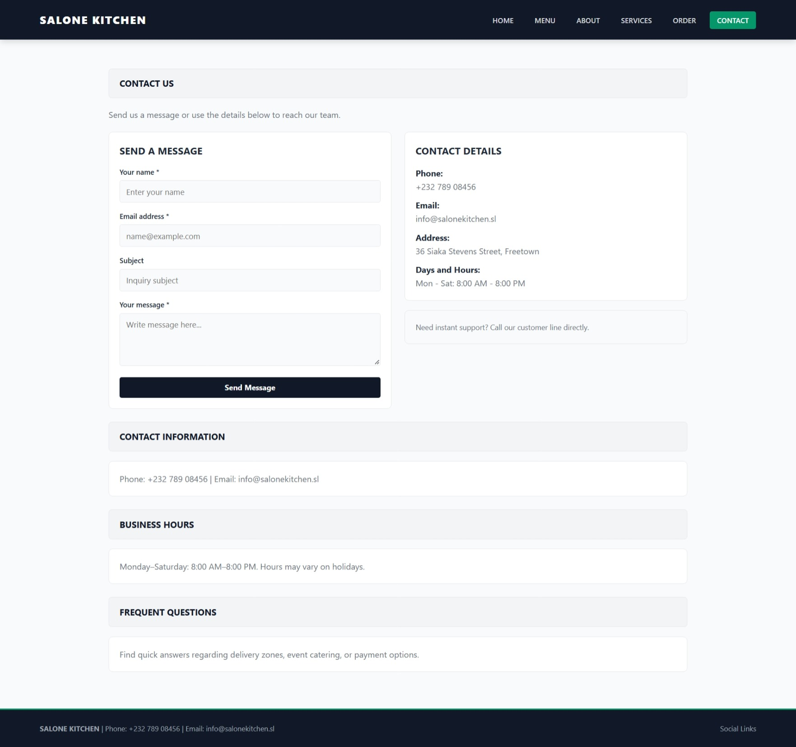

Salone Kitchen — Authentic Sierra Leonean Culinary Experience

​Author & Project Information
​Author: RUTH JOHN
​Role: Information Technology Student
​Department: Department of Information and Communication Technology
​Institution: Limkokwing University of Creative Technology, Sierra Leone
​Course Assignment: Web Design & Frontend Development

​Executive Summary
​Salone Kitchen is a vibrant, modern web application designed to highlight and celebrate the rich culinary heritage of Sierra Leone. The platform serves as an interactive online hub where users can explore traditional recipes, order authentic local dishes (such as Cassava Leaf, Potato Leaf, Groundnut Soup, Fry Fish, and Jollof Rice), and learn about traditional cooking techniques.
​The project blends modern user interface design with cultural storytelling, making Sierra Leonean gastronomy accessible to local food enthusiasts and global audiences alike.

​Key Features & Highlights
​Interactive Menu & Category Browsing: Filter traditional dishes by breakfast, lunch, dinner specials, and local beverages (e.g., Ginger Juice, Wonjo).
​Online Ordering Interface: Streamlined food selection and checkout workflow for local delivery or pickup.

​Recipe Spotlight & Cultural Insights: Detailed ingredient lists and heritage stories behind famous Sierra Leonean staple meals.
​Customer Reviews & Ratings: User feedback section displaying dining experiences and recommendations.

​Contact & Reservation Hub: Direct inquiry forms, location mapping, and contact details for dining reservations.

​Technical Standards & Architecture
​Pure HTML5 & CSS3: Semantic structure paired with responsive CSS layout modules (Flexbox and CSS Grid) for multi-device support.

​Cross-Browser Compatibility: Validated across major modern web browsers, including Mozilla Firefox, Google Chrome, and Microsoft Edge.

​Clean Code Structure: Standardized file paths and modular code organization ensuring ease of maintenance and scalability.

​Tech Stack & Setup Instructions
​Languages: HTML5, CSS3.
​Styling Theme: Warm, inviting culinary tones (Warm Amber, Deep Orange, Earthy Browns, and Clean Ivory/White).

## Salone_Kitchen Website Screenshots

### 1. Home Page

### 2. Menu Page

### 3. About Page

### 4. Services Page

### 5. Order Page

### 6. Contact Page

